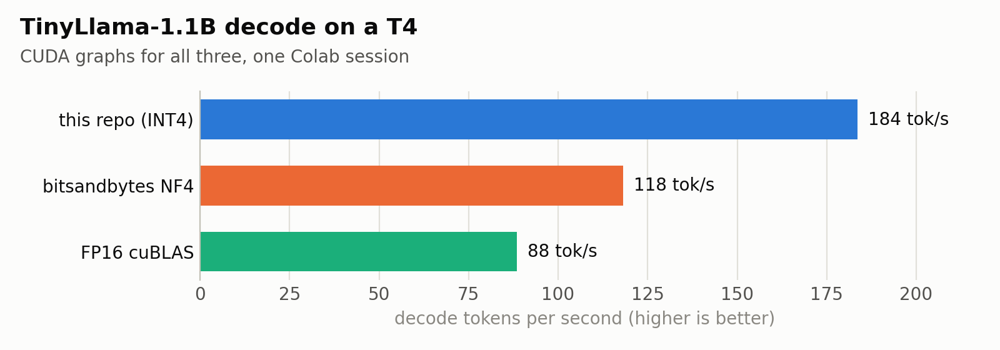
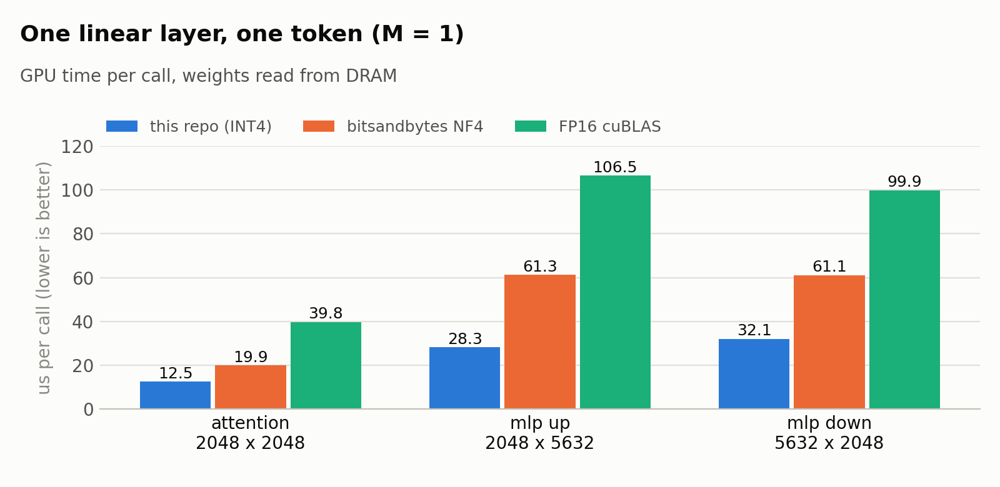
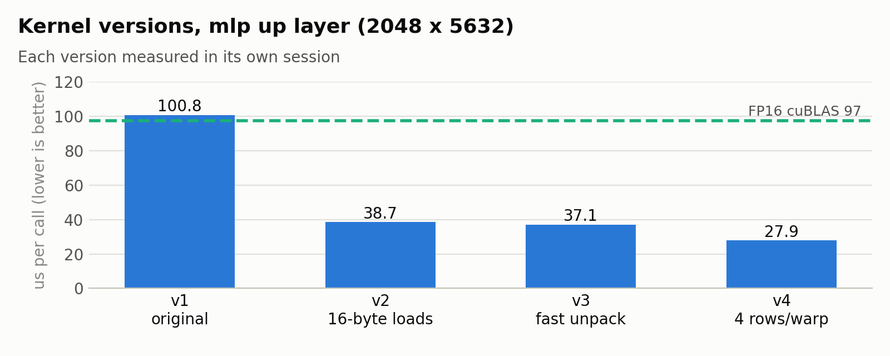

# Nibble: INT4 LLM Decode Kernel

Fused CUDA kernel that runs an LLM linear layer straight from 4-bit weights on an NVIDIA T4 (`sm_75`).

```text
FP16 activations [M, K]  x  packed INT4 weights [N, K]  ->  FP16 output [M, N]
```

- Unpack, dequantize, and multiply in one kernel; no FP16 weight matrix in memory
- Built for single-token decode (`M = 1`), plus a small-batch kernel for `M = 2..8`
- Inference only

## Highlights

- **184 tok/s** TinyLlama-1.1B decode vs **118** bitsandbytes NF4 and **88** FP16 (1.6x and 2.1x)
- **3.3x less memory** than FP16 (643 vs 2100 MiB)
- **Per layer:** 1.6x to 2.2x faster than bitsandbytes NF4, about 3x faster than FP16 cuBLAS
- **72% to 88%** of measured DRAM bandwidth

<picture>
  <source media="(prefers-color-scheme: dark)" srcset="docs/decode_dark.png">
  
</picture>

## Scope

- A kernel project, not a quantization method
- The quantizer is deliberately simple and lossy: round to nearest, symmetric, absmax per 128 weights
- No calibration, outlier handling, or error compensation (GPTQ and AWQ do that)
- Model quality is not measured; text differs from FP16 because of quantization
- Kernel correctness is checked against a Python reference on the same packed codes

## Results

- Google Colab Tesla T4, `group_size = 128`
- T4 runs power capped (`sw-power`, SM 500 to 1300 of 1590 MHz) under sustained load
- Clocks drift between sessions, so compare rows within one table

### One layer, one token (`M = 1`)

<picture>
  <source media="(prefers-color-scheme: dark)" srcset="docs/layers_dark.png">
  
</picture>

| layer (K x N) | FP16 us | bnb NF4 us | this repo us | vs bnb | %copy bnb / this repo |
| --- | --- | --- | --- | --- | --- |
| attention (2048 x 2048) | 39.8 | 19.9 | **12.5** | 1.6x | 49% / 72% |
| mlp up (2048 x 5632) | 106.5 | 61.3 | **28.3** | 2.2x | 44% / 87% |
| mlp down (5632 x 2048) | 99.9 | 61.1 | **32.1** | 1.9x | 44% / 77% |

- `%copy`: achieved GB/s vs a measured device copy (~241 GB/s; spec 320)
- Packed weights are 3.9x smaller than FP16, which caps the speedup near 3.9x
- vs FP16: 3.1x to 3.8x here; FP16 hit a 510 MHz clock on the MLP rows, and an earlier session measured 3.0x to 3.5x
- The lead over bnb is not from clocks: bnb rows ran at a higher SM clock (1170 to 1320 MHz vs 915 to 1245)
- bnb stores ~9% more bytes (FP32 absmax per 64 weights); `%copy` accounts for that
- bnb output is checked against its own dequantize + `F.linear` before timing

### Four tokens at once (`M = 4`)

| layer (K x N) | FP16 us | bnb NF4 us | this repo us |
| --- | --- | --- | --- |
| attention (2048 x 2048) | 58.6 | 51.3 | **45.6** |
| mlp up (2048 x 5632) | **100.1** | 134.6 | 134.5 |
| mlp down (5632 x 2048) | **115.7** | 140.3 | 131.0 |

- Both 4-bit kernels tie each other and lose to FP16 on the MLP layers
- They move only 45 to 50 GB/s: limited by unpack and math per weight, not memory
- The small-batch kernel still uses the v1 design; it is the next target

### Kernel versions

<picture>
  <source media="(prefers-color-scheme: dark)" srcset="docs/versions_dark.png">
  
</picture>

| version | change | effect |
| --- | --- | --- |
| v1 | original: 2-byte loads, two `__syncthreads` per group | about FP16 speed |
| v2 | 16-byte loads, no barriers, one warp reduction at the end | 2.3x to 3.2x faster than v1 |
| v3 | FP16 magic-number unpack (one LOP3 per two weights), no `I2F` | removed every `I2F`; time barely moved |
| v4 | each warp computes 4 output rows and shares activation work | 20% to 35% faster than v3 |

- v3 showed the limit was per-warp overhead, not unpacking; v4 fixes that
- Each version was measured against the previous one in its own session

Rows per warp, alternated twice in one session (mean us):

| setting | attention | mlp up | mlp down |
| --- | --- | --- | --- |
| v3, 1 row per warp | 28.0 | 37.1 | 38.7 |
| v4, 1 row per warp | 25.2 | 38.4 | 38.3 |
| v4, 2 rows per warp | 18.3 | 26.9 | 30.7 |
| v4, 4 rows per warp (default) | 18.1 | 27.9 | 30.9 |

- 2 and 4 rows tie within noise; smaller blocks alone do not help

### TinyLlama generate

- `TinyLlama/TinyLlama-1.1B-Chat-v1.0`, greedy, chat template, 32 new tokens forced
- 1 warmup, median of 5 runs
- This repo: v4 kernel for decode, CUDA dequantize + cuBLAS for prefill
- FP16 and bnb-nf4 load Hugging Face weights in FP16; this repo loads packed weights only (155 layers)

With CUDA graphs (`--cuda-graphs`, all three compiled), one session:

| mode | prompt | prefill ms | decode tok/s | e2e tok/s | peak MiB |
| --- | --- | --- | --- | --- | --- |
| FP16 | haiku | 44.1 | 90.2 | 82.5 | 2111 |
| FP16 | 2+2 | 35.1 | 88.5 | 83.0 | 2111 |
| bnb-nf4 | haiku | 44.4 | 119.4 | 105.2 | 801 |
| bnb-nf4 | 2+2 | 47.0 | 118.1 | 103.4 | 801 |
| this repo | haiku | 75.9 | 209.5* | **143.0** | **675** |
| this repo | 2+2 | 50.2 | **183.6** | **146.1** | **675** |

\* Noisy prefill (usually ~50 ms) inflates decode tok/s, since decode = total minus prefill; use the 2+2 row.

Eager (default Hugging Face generate):

| mode | prompt | prefill ms | decode tok/s | e2e tok/s | peak MiB |
| --- | --- | --- | --- | --- | --- |
| FP16 | haiku | 31.7 | 36.8 | 36.6 | 2111 |
| FP16 | 2+2 | 32.0 | 36.2 | 36.0 | 2111 |
| bnb-nf4 | haiku | 41.8 | 25.9 | 25.8 | 801 |
| bnb-nf4 | 2+2 | 42.6 | 24.5 | 24.5 | 801 |
| dequant | haiku | 44.5 | 28.3 | 28.1 | 778 |
| dequant | 2+2 | 40.4 | 28.0 | 27.9 | 778 |
| this repo | haiku | 41.7 | 36.9 | 36.3 | 674 |
| this repo | 2+2 | 39.6 | 36.9 | 36.4 | 674 |

- **vs FP16:** 2.1x decode, 1.8x end to end; 5.4 vs 11.3 ms per token
- **vs bnb:** 1.6x decode, 1.4x end to end, 19% less memory; 5.4 vs 8.5 ms per token
- Part of the bnb gap is `lm_head`: bnb keeps it in FP16 (125 MiB per token, roughly 0.4 ms); this repo quantizes it
- The gap stays below 3.9x because attention, norms, and sampling cost the same in every mode
- Eager decode is CPU bound (~27 ms per token of Python launches), so the kernel speedup is hidden
- transformers 5.20 marks bnb 4-bit as not compileable; `generate.py` overrides that so all three use CUDA graphs
- Eager bnb rows are from a later session; earlier runs left non-4-bit layers in bfloat16, which T4 emulates
- Prefill: the CUDA dequantize kernel cut fused prefill from ~172 ms to ~40 ms
- This repo and dequant produce identical greedy text

## Quick start

- Needs PyTorch with CUDA and `nvcc`; `setup.py` targets `sm_75`
- TinyLlama scripts need `transformers`; the bnb comparison needs `bitsandbytes` (skipped if missing)
- CPU tests run without a GPU; CUDA tests skip without CUDA or the extension
- Colab: [`notebooks/colab_t4.ipynb`](https://colab.research.google.com/github/chris320211/Nibble/blob/main/notebooks/colab_t4.ipynb)

```bash
python setup.py build_ext --inplace
pytest tests/

python scripts/quantize_tinyllama.py
python scripts/generate.py --mode all --checkpoint checkpoints/tinyllama-w4a16.pt
python scripts/generate.py --mode fused --checkpoint checkpoints/tinyllama-w4a16.pt --cuda-graphs
python scripts/profile_kernel.py --baselines fused resident_fp16 bnb_nf4
python scripts/plot_results.py  # redraw docs/ charts after updating numbers
```

- `--mode` is one of `fp16`, `bnb-nf4`, `dequant`, `fused`, or `all` (runs them in sequence)

## Methodology

Operator (`scripts/profile_kernel.py`):

- `kernel_us`: GPU time per call over 100 back-to-back calls replayed from a CUDA graph
- Weight copies rotate so every call reads DRAM, not the 4 MiB L2, as in real decode
- `eager_us`: one call timed alone; adds ~30 us of Python launch overhead
- `%peak` vs spec DRAM, `%copy` vs a measured device-to-device copy
- `sm_mhz`, `temp_c`, `throttle` from `nvidia-smi` sampled under load flag slowed rows

Generate (`scripts/generate.py`), per mode and prompt:

1. One untimed generate that stops at EOS; prints the text and warms up CUDA, cuBLAS, the allocator
2. `--warmup` more untimed generates (default 1)
3. `--runs` timed prefill-only generates and `--runs` timed full generates (default 5 each)

- Full generates force exactly `--max-new-tokens` tokens, so every mode decodes the same length
- `decode_ms = total_ms - prefill_ms`; `decode tok/s = (new_tokens - 1) / decode_s`

bitsandbytes comparison:

| | this repo | bitsandbytes NF4 |
| --- | --- | --- |
| codes | INT4 `[-7, 7]`, round to nearest | NF4 lookup table |
| scales | FP16 per 128 weights (~4.1 bits/weight) | FP32 absmax per 64 (~4.5 bits/weight) |
| `lm_head` | quantized | FP16 (transformers default) |

## Profiling without Nsight

Colab blocks GPU counters (`ncu` fails with `ERR_NVGPUCTRPERM`), so profiling uses:

- `profile_kernel.py`: roofline timing as above
- `inspect_kernel.py`: registers, spills, occupancy, load widths, barriers, shuffles, convert/FMA counts from `cuobjdump`; SASS goes to `profile_results/sass/`

<details>
<summary>Nsight commands for a GPU with counters enabled</summary>

```bash
ncu --target-processes all \
    --profile-from-start off \
    --kernel-name regex:int4_linear_kernel_decode \
    --launch-count 3 \
    --section SpeedOfLight --section MemoryWorkloadAnalysis \
    --section WarpStateStats --section Occupancy \
    -o profile_results/ncu_decode \
    python scripts/profile_kernel.py --baselines fused --warmup 10 --iters 5 --cuda-profiler
nsys profile -o profile_results/nsys_decode --trace=cuda,nvtx --capture-range=cudaProfilerApi \
    python scripts/profile_kernel.py --baselines fused --cuda-profiler
```

</details>

## Format

- Symmetric group-wise INT4 along `K`, default `group_size = 128`
- Codes in `[-7, 7]`, two per `uint8`: even `k` in the low nibble, odd `k` in the high nibble, two's complement
- Scale: `max(abs(w)) / 7`, or `1.0` for an all-zero group

```text
packed_weights: uint8    [N, K / 2]
scales:         float16  [N, K / group_size]
```

## Contract

- CUDA `float16` activations, packed `uint8` weights, `float16` scales, all contiguous
- Fused path: `M <= 8`, `K % 128 == 0`, `group_size = 128`, 16-byte aligned activations and weights
- `M = 1`: v4 decode kernel; `W4A16_DECODE` (`v1` to `v4`) and `W4A16_ROWS_PER_WARP` (1, 2, 4) select variants for A/B runs
- `M = 2..8`: small-batch kernel that unpacks each weight once and reuses it for every row
- `QuantizedLinear` with `M > 8` or `fused=False`: CUDA dequantize kernel (bit-identical to the Python reference) + cuBLAS
- `linear_cuda` with `M > 8`, another group size, or misaligned tensors: naive one-thread-per-output kernel
- No autograd; bias is added in Python after the op

## API

| Symbol | Role |
| --- | --- |
| `quantize_and_pack_weights` | FP16/FP32 `[N, K]` → packed weights + scales |
| `QuantizedLinear` | Inference module; `from_float` / `empty` |
| `replace_linear_layers` | Replace compatible `nn.Linear`; `packed_only=True` skips quantize |
| `load_packed_state_dict` | Empty-replace, `to_empty`, load packed weights |
| `linear_cuda` | Fused CUDA op |
| `dequantize_cuda` | Packed weights + scales → FP16 `[N, K]` on the GPU |
| `cuda_extension_available` | Whether `w4a16._C` loaded |
| `save_quantized_weight_checkpoint` | One packed tensor + metadata |
| `load_quantized_weight_checkpoint` | Load and validate one packed tensor |
